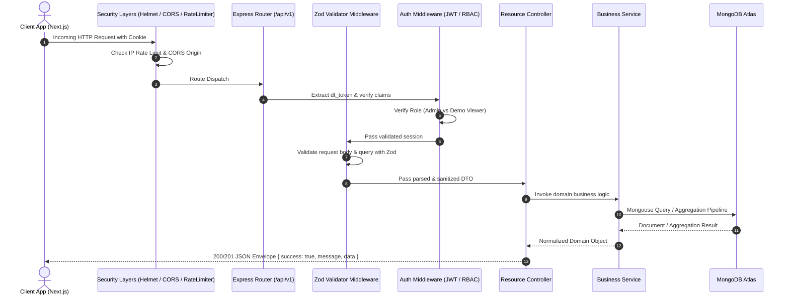
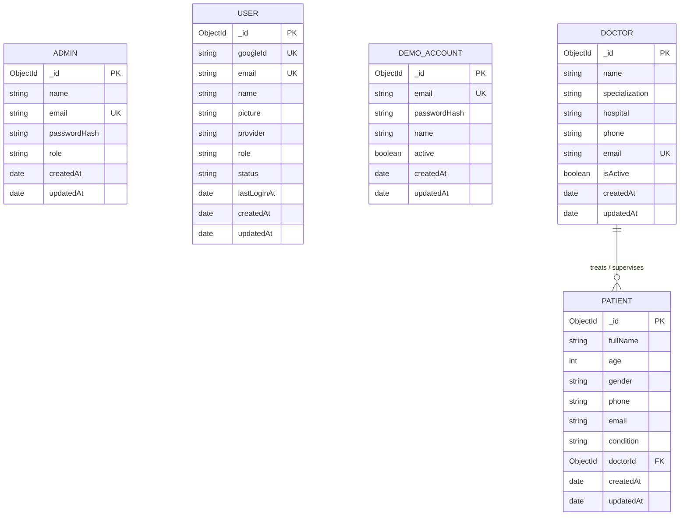

# Doctor Tracker — Backend API

[](https://nodejs.org/)
[](https://expressjs.com/)
[](https://www.mongodb.com/)
[](https://mongoosejs.com/)
[](https://jwt.io/)
[](LICENSE)

> A production-ready RESTful API for healthcare administration. Handles authentication, doctor rosters, patient records, doctor-patient assignments, and clinical analytics with strict role-based access control, secure HttpOnly cookie sessions, and an isolated read-only demo environment.

---

### 🔗 Live Links

- **API Service (Render):** [https://doctor-tracker-server-29dm.onrender.com](https://doctor-tracker-server-29dm.onrender.com)
- **API Base URL:** `https://doctor-tracker-server-29dm.onrender.com/api/v1`
- **Health Check:** [https://doctor-tracker-server-29dm.onrender.com/api/v1/health](https://doctor-tracker-server-29dm.onrender.com/api/v1/health)
- **Frontend Dashboard:** [https://doctor-tracker-client-sepia.vercel.app](https://doctor-tracker-client-sepia.vercel.app)
- **Frontend GitHub Repo:** [shahed-hassan-fz-rabbi/doctor-tracker-client](https://github.com/shahed-hassan-fz-rabbi/doctor-tracker-client)

---

## Table of Contents

- [Backend Overview](#backend-overview)
- [Architecture & Request Lifecycle](#architecture--request-lifecycle)
- [Key Features](#key-features)
- [Technology Stack](#technology-stack)
- [Authentication & Session Architecture](#authentication--session-architecture)
  - [JWT in HttpOnly Cookies](#jwt-in-httponly-cookies)
  - [Google OAuth 2.0 Integration](#google-oauth-20-integration)
  - [Role-Based Access Control (RBAC)](#role-based-access-control-rbac)
- [Database Architecture & Collections](#database-architecture--collections)
  - [Data Models](#data-models)
  - [Relationships & Referential Integrity](#relationships--referential-integrity)
- [API Endpoints Documentation](#api-endpoints-documentation)
- [Request & Response Payloads](#request--response-payloads)
- [Error Handling & API Envelope](#error-handling--api-envelope)
- [Security Implementations](#security-implementations)
- [Demo Database Isolation & Read-Only Safety](#demo-database-isolation--read-only-safety)
- [Folder Structure](#folder-structure)
- [Local Development Setup](#local-development-setup)
- [Environment Variables](#environment-variables)
- [Running Locally & Memory Mode](#running-locally--memory-mode)
- [Testing Suite](#testing-suite)
- [Deployment on Render](#deployment-on-render)
- [Roadmap & Future Enhancements](#roadmap--future-enhancements)
- [Author & Acknowledgments](#author--acknowledgments)

---

## Backend Overview

The **Doctor Tracker API** powers the operations of modern healthcare administrative teams. Built on top of **Node.js**, **Express 5**, and **MongoDB Atlas**, it provides a versioned, secure REST API (`/api/v1`) that cleanly separates business logic, data persistence, and HTTP transport layers.

It was designed from day one with security in mind:
- **No tokens in browser storage:** Session tokens live exclusively in encrypted, signed `HttpOnly` cookies.
- **Strict separation of concerns:** Every request flows through schema validation, authentication middleware, rate limiting, and dedicated services before touching MongoDB.
- **Fail-safe demo isolation:** A public portfolio sandbox cannot touch, read, or write to production clinical data under any circumstances.

---

## Architecture & Request Lifecycle



---

## Key Features

- **Versioned API Structure:** All routes organized under `/api/v1` for future compatibility.
- **Dual Authentication Engine:** Supports permanent administrative email/password authentication (hashed via `bcryptjs` with salt rounds = 12) alongside Google OAuth 2.0 with automatic `users` collection persistence and `lastLoginAt` auditing.
- **Server-Side Filtering & Pagination:** High-performance MongoDB queries support regex search, multi-field sorting, and range pagination.
- **Optimized Clinical Analytics:** Uses MongoDB aggregation pipelines (`$group`, `$facet`, `$project`) to compute hospital-wide metrics in a single roundtrip.
- **Referential Integrity Guards:** Deleting a doctor automatically frees and unassigns all associated patients without losing patient profiles.
- **Demo Mode Isolation:** An independent mode (`DEMO_MODE=true`) that routes exclusively to a replica demo database and rejects all write requests at the middleware level.

---

## Technology Stack

| Component | Technology | Purpose |
|---|---|---|
| **Runtime** | Node.js (v20+) | High-performance asynchronous JavaScript engine |
| **Framework** | Express.js (v5) | Minimalist and fast HTTP application server |
| **Database** | MongoDB Atlas (Mongoose v8) | NoSQL document database with strict schema models |
| **Authentication** | JSON Web Tokens (`jsonwebtoken`) + Google Auth Library | Secure stateless sessions and OAuth 2.0 verification |
| **Password Hashing** | `bcryptjs` (Cost factor 12) | Cryptographic protection for administrative passwords |
| **Validation** | `zod` | Declarative request payload and query parameter validation |
| **Security** | `helmet`, `cors`, `express-rate-limit` | Defense in depth against XSS, clickjacking, and DDoS |
| **Logging** | `morgan` + custom JSON logger | Structured HTTP request and application logging |
| **Test Runner** | `vitest` + `supertest` + `mongodb-memory-server` | Fast, isolated integration and unit test runner |

---

## Authentication & Session Architecture

### JWT in HttpOnly Cookies
Doctor Tracker does not return raw JWT tokens in JSON response bodies. Instead:
- Upon successful login (`POST /api/v1/auth/login` or Google OAuth callback), the server generates a signed JWT and issues an HTTP response header:
  ```http
  Set-Cookie: dt_token=<jwt>; Path=/api; HttpOnly; Secure; SameSite=None; Max-Age=604800
  ```
- **Why this matters:**
  - `HttpOnly`: Client-side JavaScript cannot read the cookie, mitigating cross-site scripting (XSS) credential theft.
  - `SameSite=None` + `Secure`: Allows the cookie to travel safely between the Vercel frontend domain and the Render backend domain over HTTPS.
- Logging out (`POST /api/v1/auth/logout`) immediately overwrites the cookie with an expired timestamp.

### Google OAuth 2.0 Integration
- Users can authenticate using their Google accounts (`GET /api/v1/auth/google`).
- Upon callback verification (`GET /api/v1/auth/google/callback`), the server securely validates the Google ID token.
- If it is the user's first login, a record is created in the `users` collection with `role: 'viewer'`.
- On subsequent logins, their `lastLoginAt` timestamp is updated without duplicating accounts.
- By default, Google users receive the `viewer` role and are guided to an administrative request page (`/restricted`) until elevated.

### Role-Based Access Control (RBAC)

| Middleware Guard | Target Routes | Allowed Roles |
|---|---|---|
| `requireAdmin` | `POST /doctors`, `PATCH /doctors/:id`, `DELETE /doctors/:id`<br>`POST /patients`, `PATCH /patients/:id`, `DELETE /patients/:id` | `admin` |
| `requireAdminOrDemoViewer` | `GET /doctors`, `GET /doctors/:id`<br>`GET /patients`, `GET /patients/:id`<br>`GET /analytics/*` | `admin`, `demo-viewer` |
| `requireProductionAuth` | `POST /auth/login`, `GET /auth/google*` | Production requests only |
| `requireDemoMode` | `POST /auth/demo-login` | Demo instance only |

---

## Database Architecture & Collections

### Data Models



### Relationships & Referential Integrity
- **Doctor → Patients (One-to-Many):** Patients reference their primary physician via `doctorId` (`ref: 'Doctor'`).
- **Nullability:** Patients can exist in an unassigned state (`doctorId: null`), representing incoming triaged patients awaiting assignment.
- **Safe Cascade Behavior:** When a doctor is deleted via `DELETE /api/v1/doctors/:id`, a pre-hook/service transaction automatically sets `doctorId: null` across all patients assigned to that doctor. No patient records are deleted.

---

## API Endpoints Documentation

All routes are prefixed with `/api/v1`.

### System & Health

| Method | Endpoint | Auth | Purpose |
|---|---|---|---|
| `GET` | `/health` | Public | Server uptime and MongoDB connection status. |
| `GET` | `/` | Public | API root discovery and version metadata. |

### Authentication

| Method | Endpoint | Auth | Purpose |
|---|---|---|---|
| `POST` | `/auth/login` | Public | Admin login via email & password. Sets `dt_token` cookie. |
| `POST` | `/auth/demo-login` | Public (Demo Mode) | Demo login for `demo@doctortracker.com`. |
| `GET` | `/auth/me` | Authenticated | Returns current authenticated user profile & role. |
| `POST` | `/auth/logout` | Authenticated | Clears session cookie and invalidates client session. |
| `GET` | `/auth/google` | Public | Initiates Google OAuth 2.0 authorization redirect. |
| `GET` | `/auth/google/callback` | Public | OAuth callback: validates code, issues session cookie. |

### Doctors Management

| Method | Endpoint | Auth | Purpose |
|---|---|---|---|
| `GET` | `/doctors` | Admin / Viewer | List doctors with search, filters, sorting & pagination. |
| `POST` | `/doctors` | Admin Only | Create a new doctor record. |
| `GET` | `/doctors/:id` | Admin / Viewer | Get single doctor details, including caseload count. |
| `PATCH` | `/doctors/:id` | Admin Only | Update doctor details (specialization, hospital, etc.). |
| `DELETE` | `/doctors/:id` | Admin Only | Delete doctor (unassigns their active patients). |
| `GET` | `/doctors/:id/patients` | Admin / Viewer | List all patients currently assigned to this doctor. |
| `POST` | `/doctors/:id/patients` | Admin Only | Assign an existing patient to this doctor. |
| `DELETE` | `/doctors/:id/patients/:patientId`| Admin Only | Unassign a patient from this doctor. |

### Patients Management

| Method | Endpoint | Auth | Purpose |
|---|---|---|---|
| `GET` | `/patients` | Admin / Viewer | List patients with multi-field search and filters. |
| `POST` | `/patients` | Admin Only | Create a new patient record (with optional doctor assignment). |
| `GET` | `/patients/:id` | Admin / Viewer | Get single patient profile with assigned doctor details. |
| `PATCH` | `/patients/:id` | Admin Only | Update patient information or assigned doctor. |
| `DELETE` | `/patients/:id` | Admin Only | Permanently delete a patient record. |

### Analytics & Reporting

| Method | Endpoint | Auth | Purpose |
|---|---|---|---|
| `GET` | `/analytics/overview` | Admin / Viewer | Key stats: total doctors, active staff, patient counts. |
| `GET` | `/analytics/patient-growth` | Admin / Viewer | Monthly patient registration trend data. |
| `GET` | `/analytics/patients-by-condition`| Admin / Viewer | Breakdown of patients by medical diagnosis. |
| `GET` | `/analytics/patients-per-doctor` | Admin / Viewer | Patient caseload distribution across doctors. |
| `GET` | `/analytics/doctor-specializations`| Admin / Viewer | Doctor count distribution by medical specialty. |

---

## Request & Response Payloads

All responses conform to a unified JSON envelope:

### 1. Success Response Structure
```json
{
  "success": true,
  "message": "Doctors retrieved successfully",
  "data": {
    "doctors": [
      {
        "id": "6732f91a82bc92001a112233",
        "name": "Dr. Sarah Jenkins",
        "specialization": "Cardiology",
        "hospital": "St. Marina Medical Center",
        "phone": "+1 415 555 0192",
        "email": "dr.jenkins@clinic.example.com",
        "isActive": true,
        "patientCount": 12,
        "createdAt": "2026-08-14T10:15:00.000Z"
      }
    ],
    "pagination": {
      "page": 1,
      "limit": 10,
      "total": 40,
      "totalPages": 4
    }
  }
}
```

### 2. Error Response Structure
```json
{
  "success": false,
  "message": "Validation failed",
  "errors": [
    {
      "field": "specialization",
      "message": "Invalid specialization. Must be one of the recognized medical specialties."
    }
  ]
}
```

---

## Security Implementations

1. **Helmet HTTP Headers:** Automatically applies Content Security Policy (CSP), hides `X-Powered-By`, forces HSTS, and prevents MIME-sniffing.
2. **Explicit CORS Matching:** Validates `Origin` against a strict whitelist configured in `CORS_ORIGINS`. Disallows wildcard origins (`*`) when credentials (`credentials: true`) are enabled.
3. **Dual Tier Rate Limiting:**
   - General API limiter: 300 requests per 15-minute window.
   - Authentication limiter: 10 attempts per 15-minute window to defend against brute-force attacks.
4. **Input Sanitization with Zod:** Every incoming body and query parameter is parsed against a strict schema. Unknown fields are stripped automatically.
5. **Zero Secret Leakage:** Diagnostic endpoints and error formatters never echo database connection strings, passwords, or stack traces in production.

---

## Demo Database Isolation & Read-Only Safety

Doctor Tracker provides a public demo instance for evaluation without compromising production integrity:

- **Separate Database User:** The demo environment connects strictly to `doctor-tracker-demo` using a database user granted only `read` privileges.
- **Middleware Lockout:** In demo mode (`DEMO_MODE=true`), all non-GET routes on doctors and patients immediately return `403 Forbidden`:
  ```json
  {
    "success": false,
    "message": "Write operations are disabled in demo mode."
  }
  ```
- **JWT Issuer Verification:** Demo JWTs contain a distinct claim (`issuer: 'doctor-tracker-demo'`). The production server rejects demo tokens, and the demo server rejects production admin tokens.

---

## Folder Structure

```text
doctor-tracker-server/
├── scripts/
│   ├── devMemory.js          # Boots in-memory MongoDB stack for local demo testing
│   ├── seedAdmin.js          # Interactive terminal prompt to provision the first Admin
│   ├── seedDemoData.js       # Generates 40 synthetic doctors & 260 patients in demo DB
│   └── seedDemoAccount.js    # Provisions demo@doctortracker.com viewer account
├── src/
│   ├── config/
│   │   ├── database.js       # Mongoose connection & pool settings
│   │   ├── env.js            # Zod-validated environment schema & guards
│   │   └── mongoUri.js       # URI safety & database name validators
│   ├── controllers/          # Request handlers (auth, doctors, patients, analytics)
│   ├── middlewares/          # Auth, error, rateLimit, and Zod validator middlewares
│   ├── models/               # Mongoose schemas (Admin, User, Doctor, Patient, DemoAccount)
│   ├── routes/               # Modular versioned routes
│   ├── services/             # Business logic & database operations
│   ├── utils/                # Standardized response envelopes, errors, and logger
│   ├── validators/           # Zod validation schemas
│   ├── app.js                # Express app setup and middleware pipeline
│   └── server.js             # HTTP server listener & graceful shutdown handlers
├── tests/                    # Vitest integration test suites
└── package.json
```

---

## Local Development Setup

### Prerequisites
- **Node.js**: `v20.0.0` or newer
- **MongoDB**: Local MongoDB instance or free MongoDB Atlas cluster

### Step 1: Clone the Repository
```bash
git clone https://github.com/shahed-hassan-fz-rabbi/doctor-tracker-server.git
cd doctor-tracker-server
```

### Step 2: Install Dependencies
```bash
npm ci
```

### Step 3: Configure Environment
Copy `.env.example` to `.env`:
```bash
cp .env.example .env
```
Populate `.env` with your development values (see [Environment Variables](#environment-variables)).

### Step 4: Provision an Initial Administrator
To create your first admin account without exposing passwords in files:
```bash
npm run seed:admin
```
The script will prompt you interactively in your terminal for an email and a secure password.

### Step 5: Start the API
```bash
npm run dev
```
The API will start at [http://localhost:4000/api/v1](http://localhost:4000/api/v1).

---

## Environment Variables

| Variable | Required | Description | Example (Local) |
|---|:---:|---|---|
| `NODE_ENV` | Yes | Environment mode (`development`, `test`, `production`) | `development` |
| `PORT` | No | Server HTTP port (defaults to 4000) | `4000` |
| `MONGODB_URI` | Yes | Complete MongoDB connection URI (must include DB name) | `mongodb://localhost:27017/doctor-tracker` |
| `JWT_SECRET` | Yes | 16+ character random secret for signing production tokens | `your-secure-jwt-secret-string` |
| `JWT_EXPIRES_IN` | No | Token expiration duration | `7d` |
| `COOKIE_NAME` | No | Session cookie name | `dt_token` |
| `COOKIE_SECURE` | Yes | Set `true` in production for HTTPS-only cookies | `false` |
| `CORS_ORIGINS` | Yes | Comma-separated list of allowed frontend origins | `http://localhost:3000` |
| `FRONTEND_ORIGIN` | Yes | Primary client origin for Google OAuth redirects | `http://localhost:3000` |
| `GOOGLE_CLIENT_ID`| No | Google OAuth 2.0 Web Client ID *(Optional in dev)* | `your-client-id.apps.googleusercontent.com` |
| `GOOGLE_CLIENT_SECRET`| No | Google OAuth 2.0 Client Secret *(Optional in dev)* | `GOCSPX-your-secret` |
| `GOOGLE_CALLBACK_URL` | No | Redirect URI registered in Google Console | `http://localhost:4000/api/v1/auth/google/callback` |

---

## Running Locally & Memory Mode

If you do not want to install MongoDB locally or configure an Atlas cluster, you can run the entire API against a temporary in-memory database:

```bash
npm run dev:memory
```
This command automatically:
1. Spawns an in-memory MongoDB replica via `mongodb-memory-server`.
2. Seeds 40 synthetic doctors and 260 synthetic patients.
3. Provisions a demo account: `demo@doctortracker.com` / `Demo@123`.
4. Starts the Express API on port `4000` ready for local testing.

---

## Testing Suite

The backend features automated integration and unit tests using `vitest`, `supertest`, and `mongodb-memory-server`.

Run all test suites:
```bash
npm test
```

Test coverage includes:
- **Authentication:** Admin login, cookie handling, session profile retrieval, logout.
- **RBAC & Security:** Admin routes blocked for viewers, demo viewer read permissions, write rejections.
- **Doctor CRUD:** Creation, pagination, filtering by specialization, cascaded patient unassignment on deletion.
- **Patient CRUD:** Validation schemas, assignment to doctors, status filtering.
- **Analytics:** Aggregations for patient growth, specializations, and caseload balance.
- **Database Diagnostics:** Connection URI validation and error handling without secret exposure.

---

## Deployment on Render

1. Create a new **Web Service** on [Render](https://render.com) connected to `shahed-hassan-fz-rabbi/doctor-tracker-server`.
2. Configure settings:
   - **Environment:** `Node`
   - **Build Command:** `npm ci`
   - **Start Command:** `node src/server.js`
3. Add Environment Variables:
   - `NODE_ENV`: `production`
   - `MONGODB_URI`: Your production MongoDB Atlas URI targeting `/doctor-tracker`
   - `JWT_SECRET`: High-entropy 32+ character secret
   - `COOKIE_SECURE`: `true`
   - `CORS_ORIGINS`: Exact Vercel domain, e.g. `https://doctor-tracker-client-sepia.vercel.app`
   - `FRONTEND_ORIGIN`: Same as above
   - `GOOGLE_CLIENT_ID` & `GOOGLE_CLIENT_SECRET`: Configured from Google Cloud Console
   - `GOOGLE_CALLBACK_URL`: `https://doctor-tracker-server-29dm.onrender.com/api/v1/auth/google/callback`

---

## Roadmap & Future Enhancements

- [ ] **Audit Logs Collection:** Track administrative mutations (who reassigned or deleted a patient) with IP and timestamp history.
- [ ] **Automated Daily Backups:** S3/GCS automated snapshot triggers for clinical collections.
- [ ] **Email Notifications:** Send welcome emails or assignment alerts to doctors via SendGrid / Resend.
- [ ] **Bulk Import / Export API:** Multipart CSV ingestion for bulk patient onboarding.
- [ ] **Redis Caching Layer:** Cache high-traffic summary analytics endpoints.

---

## Author & Acknowledgments

- **Developed by:** Shahed Hassan ([@shahed-hassan-fz-rabbi](https://github.com/shahed-hassan-fz-rabbi))
- **Frontend Dashboard:** [doctor-tracker-client](https://github.com/shahed-hassan-fz-rabbi/doctor-tracker-client)
- **Built with:** Node.js, Express, MongoDB Atlas, and Mongoose.

---

*Doctor Tracker API — Secure, Scalable Healthcare Backend.*
